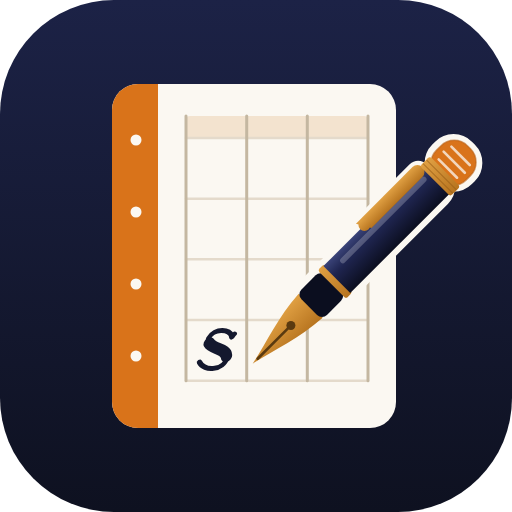

<p align="center"></p>

# Notation

**A handwriting-and-audio notebook for Carnatic music and chants.**

Write your notation by hand on tāḷa templates, record the lesson, and let every mark sing back. Tap a mark on the page and Notation plays the passage that was being sung when you made it.

Notation grew out of many years of using a general note-taking app for Carnatic lessons, and from noticing where a general app falls short for music. It is built around one way of working:

1. **Before class**, write the notation on a template, such as Ādi, Rūpaka or Miśra Chāpu, or start from a plain grid.
2. **In class**, press Record. Each time a line or saṅgati begins, place a small mark in the margin. Every mark becomes an audio bookmark.
3. **When practising**, tap any mark to hear that passage. Loop it, or slow it down.

The same approach works for chants and ślokas: bring in the script as a PDF, record the chanting, and mark each verse.

## What it does

- **Pens:** an even-weight pen for notation in five sizes, and a pressure-sensitive calligraphy pen with a broad nib for headings.
- **Colour:** five built-in colours plus your own palette, with a colour picker and an eyedropper that picks any colour from the page.
- **Highlighter, eraser, undo and redo.** Apple Pencil writes, and fingers scroll and tap.
- **Lasso:** select ink freehand or with a rectangle, then move, copy, cut, duplicate, recolour or delete it. Paste works across pages and notes. On a Mac, ⌘C, ⌘X, ⌘V, ⌘D and Delete work too.
- **Several recordings per note:** record each class, or add audio files edited elsewhere. Name them, put them in order, and they can play one after another. They're named *Title_01*, *Title_02*… in order until you rename them, and Drive uses the same names.
- **Audio bookmarks:** anything you draw while recording, or while a recording plays, is linked to that moment in that recording.
- **Point tool:** tap any linked mark (pen, calligraphy or highlighter) to play from that moment. Tap ink written before class to link it to wherever the recording is now.
- **Practice:** tap-to-play with a short lead-in, loop a passage, play at 0.5×, 0.75×, 1×, 1.25× or 2×, and follow along as the page scrolls. Jumping to a bookmark from the list or the timeline turns straight to its page.
- **Three template libraries, to mix and match in any notebook:**
  - *Notation templates:* Ādi, Rūpaka, Miśra Chāpu, Khaṇḍa Chāpu, Viloma Chāpu, Tisra Triputa, Khaṇḍa Triputa, Miśra Jhampa, a plain grid and a dot grid.
  - *Covers & dividers:* 22 hand-printed textile designs, each with a label holder for the title.
  - *Index & trackers:* Song details, an Index of the compositions in a notebook, and a three-month Practice tracker for class and practice days.
- **Your own designs:** add any PDF or image to any library. A new note guides you through a notation template and a cover; after that, add pages from any library, or from your own files, wherever you like.
- **Smooth ink:** both pens iron out the Pencil's tiny tremors while keeping corners crisp; the calligraphy pen draws its broad strokes along clean curves, from a fine hairline at a light touch to a full, broad stroke when you press firmly. The pen, calligraphy nib and highlighter have distinct icons.
- **Text:** choose the text tool, drag out a box (or tap for a standard width) and type. Font and size apply to the box; bold, italic and underline to the words you select; alignment and colour from the toolbar. To move a box, drag it with the Text tool or the Lasso (a tap with the Text tool opens it for typing); while typing, drag the orange tab. The side handle changes its width. Text appears in thumbnails, the Drive PDF and shared players.
- **Six curated fonts:** **Garamond** (EB Garamond) for body text, **Mukta Malar** (sans, Tamil and Latin), **Cormorant** (Cormorant Garamond) for titles, **Script** (Notation Script, a calligraphy face based on Allura), **Tamil Serif** (Noto Serif Tamil) and **Devanagari** (Noto Sans Devanagari, for Sanskrit, with Vedic marks). Transliteration letters (ā ḷ ṇ ś …), Tamil and Devanagari show correctly whichever font a box uses. The fonts are bundled with the app, so they work offline.
- **Zoom the notebook:** the magnifier opens − and +, **Whole page** (a full page inside the window, handy for writing neatly) and **Page width**, plus 75–200%. Pinch with two fingers on the iPad, or on a Mac trackpad, to zoom the notebook around your fingers; the rest of the screen stays put. Your zoom is remembered.
- **Hold to straighten:** draw a line, a rough rectangle or square, a circle, an ellipse or a triangle with any pen or the highlighter, and keep the Pencil still at the end for a moment. It snaps into a clean shape (lines close to level or upright become exactly level or upright). Undo returns your original stroke.
- **Stickers:** select any ink with the lasso (a *Pallavi* heading, a numbered saṅgati box, a play mark, a separator) and tap **☆ Sticker** to keep it. The sticker button on the toolbar holds your collection: tap one, then tap where it goes, and drag or resize it with **−** and **+**. Your stickers sync through Google Drive.
- **Śruti box:** a tambura sits beside the record button. Tap it to play or stop the drone; the pill beside it shows your pitch and opens Pa / Ma and volume. While you record, the drone is mixed digitally under your voice (Soft or Medium, or Off) so it is captured cleanly, never above you. Settings → Śruti holds your pitch (low 6 to 7, A2–B3), Panchama or Madhyama, the recording level, and advanced tuning (fine tune, cycle, jivāri, volume). The sound is synthesised in the app, from Lakshmi's Shruti app, so it works offline. Recordings made with it are marked "with śruti".
- **Record button:** a microphone and **REC** (REC + once a note has recordings); STOP while recording.
- **Recordings panel:** drag a recording by its grip (⠿) to move it, with a finger, the Pencil or a trackpad (or focus the grip and use the arrow keys). Positions stay 1, 2, 3 …: a numbered name (*Title_01* …) follows its new position, a name you gave keeps, and its audio bookmarks travel with it. The download button beside each recording saves it under its name as **MP3** (small, for WhatsApp), **WAV** (uncompressed, for editing) or the file as recorded; on the iPad, **Share…** opens the share sheet (WhatsApp, Save to Files …). Your choice of format is remembered.
- **Recording quality:** Notation asks each device for its best: 48 kHz, stereo where available, a high bitrate (up to 256 kbps). **Music** mode (for singing) switches off all voice-call processing, which would otherwise dip held notes and gamakas, and adds only a gentle clean-up: a 60 Hz high-pass that takes out rumble and much of the mains hum, and a soft limiter that touches only the loudest instants. **Voice** mode (for speaking) keeps the browser's noise reduction. **Level** depends on the microphone, with nothing to set. A **built-in** mic (iPad, MacBook) is quiet and usually far away, so Notation lifts the voice by up to +30 dB, following its typical loudness so a Pencil tap or a cough doesn't hold it down. It rises only while someone is singing, and the śruti follows the voice, Soft about 20 dB below it and Medium about 15 dB. An **external** mic, such as a Blue Yeti, is recorded as it is: nothing lifts its hiss or the room, and the śruti is a fixed, gentle bed beneath the voice. The tambura's tone is gently mellowed, with the jivāri's sharp top and each pluck's tick rounded off, both while it plays and in recordings. While you record, a thin light in the REC button shows your level and turns amber when the microphone is at its limit. Choose an external microphone and the mode in Settings; each recording notes what it was made with.
- **PDF links are kept:** when you bring in a PDF with its own links (an index that jumps to each verse, "back to index" links, web links), Notation keeps them. Tap a link with your finger (or with the Hand tool) to follow it; a **Back** button then returns you to where you were. Links keep pointing at the right page when you reorder pages, and they carry through to the Drive PDF, your other devices and shared players.
- **Finger gestures:** tap the page with two fingers to undo and three to redo. Settings → Finger gestures lets you choose the tap for each, or switch it off. Pinching, scrolling and the Pencil work as before.
- **Page menu:** each page's ⋯ button offers Move up, Move down, **Duplicate** (a copy with its ink and typed text), **Clear page** (removes what you wrote, drew or typed, and keeps the template or imported page; undo brings it back), Delete page and Add pages after.
- **Page sidebar:** open the panel beside the back button to see every page of a notebook as a thumbnail with your ink. Tap one to go there, star pages (☆) and show only starred ones, and name pages (✎) such as *Pallavi* or *Index*, so the sidebar reads like a table of contents. Stars and names sync through Drive, and shared players show the names too.
- **Notation books:** import a PDF of any length, or a set of photos and scans, then add, move or remove pages.
- **Folders:** Music and Chants come built in, with one level of subfolders. **Arrange** (beside the Folders heading) lets you drag folders and subfolders into any order with a finger, the Pencil or a mouse; each folder's ⋯ menu can give it a colour (red, yellow, blue, green or purple). Order and colours sync through Google Drive.
- **Share links:** publish a note as a view-only player at its own web address, with one tap. Listeners see your pages and ink, hear every recording and tap a mark to hear that passage, in any browser and without the app. You can also share a PDF of the pages, or download the player as a single file.
- **Offline:** once opened online, Notation works without Wi-Fi.

Pages are sized for the iPad Pro 11" screen (2388 × 1668).

## Using it

Notation is a web app. It runs in the browser and can be added to the Home Screen or Dock like a native app.

- **iPad:** open the site in Safari, then Share → **Add to Home Screen**.
- **Mac:** open the site in Safari, then File → **Add to Dock**.
- **iPhone:** works as a reference viewer, the same way as on iPad.

The microphone works only when Notation is opened from its `https://` address.

## Where your notes live

Notes and recordings are stored on each device, inside the app.

**Google Drive sync** (optional) keeps a mirror of the whole library in your own Google Drive, in a folder called **Notation**:

```
Notation/
├── Music/
│   └── Varṇams/
│       └── Sami ninne kori/
│           ├── Sami ninne kori.pdf  (every page with your ink: readable anywhere)
│           ├── note.json            (ink, bookmarks and details, kept editable)
│           ├── Sami ninne kori_01.m4a  (recordings, numbered in the order you set)
│           └── Class 2 · charaṇam.m4a  (…or the name you gave it in Notation)
├── Chants/
└── library.json                 (your folders)
```

Changes sync a few seconds after you make them, in both directions, so the iPad and the web app share one library. Renames, moves and deletions follow, and anything deleted goes to Drive's trash. If the same note is edited on two devices before they sync, both versions are kept. Notation can only see the files it creates in your Drive.

**Notation leads; Drive is a mirror.** Everything flows from Notation to Drive, never the other way. Name and organise things in Notation and Drive follows at the next sync:

- The note's title names its Drive folder and its PDF.
- Each recording is named after the note, numbered in order: *Title_01*, *Title_02* … Rename a recording in Notation (Recordings → rename) and Drive takes that name instead; clear the name to go back to the numbered one.
- A name changed directly in Drive is changed back at the next sync, and files you add to the Notation folder yourself are ignored: Notation can only see the files it made.
- Notation remembers every file it makes and tidies away any duplicate copies it finds.

To connect, tap **Google Drive** in the library and paste your Google client ID (see *Setting up Google Drive* below).

Your own template and cover designs stay on each device for now.

## Setting up Google Drive (once)

1. In [Google Cloud Console](https://console.cloud.google.com/), create a project called **Notation**.
2. Under **APIs & Services → Library**, enable the **Google Drive API**.
3. Set up the **OAuth consent screen** (Google Auth Platform): app name *Notation*, audience **External**, and add your own Google account as a **test user**.
4. Under **Credentials** (or **Clients**), create an **OAuth client ID** of type **Web application** with:
   - Authorised JavaScript origin: `https://lakshmiganesan.github.io`
   - Authorised redirect URI: `https://lakshmiganesan.github.io/notation/`
5. Copy the client ID (it ends in `.apps.googleusercontent.com`), open Notation from your Home Screen, tap **Google Drive**, paste it and tap **Connect**.

Google signs you in for an hour at a time. Notation renews this quietly when it opens; if it can't, the library shows **Reconnect Drive**.

## Share links

**Share → Interactive player → Publish link** puts a view-only player of the note in this repository, in the `shared/` folder, and gives you its link:

```
https://lakshmiganesan.github.io/notation/shared/sami-ninne-kori/
```

- **Anyone with the link can open it.** It plays the recordings and shows the pages with your ink and bookmarks. Nothing can be written, changed or recorded.
- **The address comes from the title** (accents dropped; a short code for titles in other scripts), and stays the same when you **Update** the player after editing the note. Notes with the same title get `-2`, `-3`…
- **Shared notes wear a saffron *Shared* badge** in your library. Tap the badge to copy the link.
- **Stop sharing** removes the player, and the link stops working within a minute or two. Git keeps past versions in the repository history.
- Players ask search engines not to list them, but the repository is public, so treat anything you share as public.
- GitHub takes about a minute to put a new or updated player online. Each recording can be up to 100 MB.

**Setting up (once on each device):** on GitHub, open Settings → Developer settings → Personal access tokens → **Fine-grained tokens** → Generate new token. Give it access to **Only select repositories → LakshmiGanesan/notation**, then **+ Add permissions → Contents → Read and write**. Copy the token and paste it in Notation's **Settings → Share links**. The token stays on that device; it is never synced to Drive or put into anything you share. Once set up, Settings shows a short status; replacing or removing the token sits behind **Manage token…**.

## Quarterly tidy-up reminder

On the first visit of each quarter (1 January, 1 April, 1 July and 1 October, from 2027), the library opens with a short note: back up the Notation folder in Google Drive to a hard disk, let go of notes you no longer need, and keep what matters. Nothing is done automatically. **Remind me next week** or **Done for this quarter** puts it away; Settings can turn it off.

## Fonts

EB Garamond, Mukta Malar, Cormorant Garamond, Noto Serif Tamil and Noto Sans Devanagari are used under the SIL Open Font License 1.1. **Notation Script** is a modified version of **Allura** by TypeSETit, LLC (SIL Open Font License 1.1, Reserved Font Name "Allura"), with the transliteration letters ṛ ṝ ḷ ḹ ṅ ṭ ḍ ṇ ṣ ḥ ṃ and their capitals added from Allura's own glyphs; its licence is in `fonts/NotationScript-OFL.txt`.

## Updates

The version shows at the top of the library (for example **v0.38**). Notation checks for a newer version when it opens, when you return to it, and every half hour; when there is one, the label turns saffron and reads **Update to …**. Tap it to load the newest version straight away. Your notes, recordings, folders and Drive connection are kept. **Settings → Check for updates** does the same.

## Status

Notation is in active, personal development. Features and storage formats may still change.

## In this repository

| Path | What it holds |
|---|---|
| `index.html` | The app |
| `templates/` | Notation templates, covers, index and tracker pages, and their previews |
| `lib/pdfjs/` | The PDF reader used for importing PDFs ([PDF.js](https://mozilla.github.io/pdf.js/), Apache 2.0) |
| `lib/lame/` | The MP3 encoder used when downloading a recording as MP3 ([LAME](https://lame.sourceforge.io/), via lamejs, LGPL; unmodified, loaded only when needed; licence in `lib/lame/LICENSE.txt`) |
| `icons/`, `manifest.webmanifest` | App icon and install details |
| `sw.js` | Offline support |
| `shared/` | Players published from Notation with Share → Publish link, one folder per note |

## Copyright

© 2026 Lakshmi Ganesan. All rights reserved.

The code, templates, cover designs and icon in this repository are not licensed for reuse, copying or redistribution. You may view them here, but please do not copy or republish them without written permission. PDF.js is included under its own Apache 2.0 licence, and LAME (lamejs) under the LGPL.
