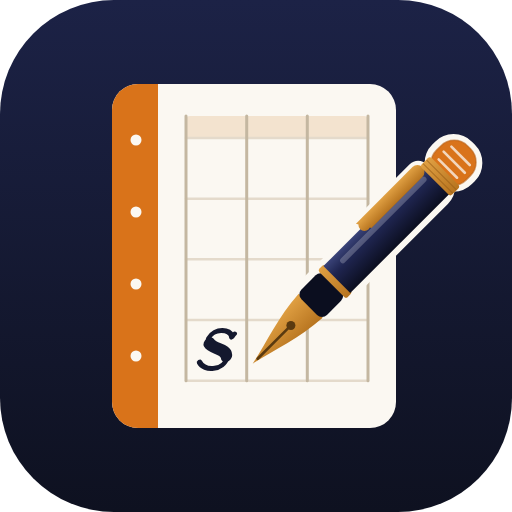

<p align="center"></p>

# Notation

**A handwriting-and-audio notebook for Carnatic music and chants.**

Write your notation by hand on tāḷa templates, record the lesson, and let every mark sing back. Tap a mark on the page and Notation plays the passage that was being sung when you made it.

Notation grew out of many years of using a general note-taking app for Carnatic lessons, and from noticing where a general app falls short for music. It is built around one way of working:

1. **Before class**, write the notation on a template, such as Ādi, Rūpaka or Miśra Chāpu, or start from a plain grid.
2. **In class**, press Record. Each time a line or saṅgati begins, place a small mark in the margin. Every mark becomes an audio bookmark.
3. **When practising**, tap any mark to hear that passage. Loop it, or slow it down.

The same approach works for chants and ślokas: bring in the script as a PDF, record the chanting, and mark each verse.

## What it does

- **Pens:** an even-weight pen for notation in five sizes, and a pressure-sensitive calligraphy pen with a broad nib for headings.
- **Colour:** five built-in colours plus your own palette, with a colour picker and an eyedropper that picks any colour from the page.
- **Highlighter, eraser, undo and redo.** Apple Pencil writes, and fingers scroll and tap.
- **Lasso:** select ink freehand or with a rectangle, then move, copy, cut, duplicate, recolour or delete it. Paste works across pages and notes. On a Mac, ⌘C, ⌘X, ⌘V, ⌘D and Delete work too.
- **Several recordings per note:** record each class, or add audio files edited elsewhere. Name them, put them in order, and they can play one after another. In Drive they're saved as *Title_01*, *Title_02*… in that order.
- **Audio bookmarks:** anything you draw while recording, or while a recording plays, is linked to that moment in that recording.
- **Point tool:** tap any linked mark (pen, calligraphy or highlighter) to play from that moment. Tap ink written before class to link it to wherever the recording is now.
- **Practice:** tap-to-play with a short lead-in, loop a passage, slow down to 0.75× or 0.5×, or speed up to 2× or 3×, and follow along as the page scrolls. Jumping to a bookmark from the list or the timeline turns straight to its page.
- **Templates:** Ādi, Rūpaka, Miśra Chāpu, Khaṇḍa Chāpu, Viloma Chāpu, Tisra Triputa, Khaṇḍa Triputa, Miśra Jhampa, and a plain grid.
- **Covers and section dividers:** a Song details page, plus 22 hand-printed textile designs, each with a label holder for the title.
- **Your own designs:** add any PDF or image to either library.
- **Notation books:** import a PDF of any length, or a set of photos and scans, then add, move or remove pages.
- **Folders:** Music and Chants come built in, with one level of subfolders.
- **Sharing:** share a note as an interactive player (notation and audio, in any browser) or as a PDF of its pages with your ink.
- **Offline:** once opened online, Notation works without Wi-Fi.

Pages are sized for the iPad Pro 11" screen (2388 × 1668).

## Using it

Notation is a web app. It runs in the browser and can be added to the Home Screen or Dock like a native app.

- **iPad:** open the site in Safari, then Share → **Add to Home Screen**.
- **Mac:** open the site in Safari, then File → **Add to Dock**.
- **iPhone:** works as a reference viewer, the same way as on iPad.

The microphone works only when Notation is opened from its `https://` address.

## Where your notes live

Notes and recordings are stored on each device, inside the app.

**Google Drive sync** (optional) keeps a mirror of the whole library in your own Google Drive, in a folder called **Notation**:

```
Notation/
├── Music/
│   └── Varṇams/
│       └── Sami ninne kori/
│           ├── Sami ninne kori.pdf  (every page with your ink: readable anywhere)
│           ├── note.json            (ink, bookmarks and details, kept editable)
│           ├── Sami ninne kori_01.m4a  (recordings, numbered in the order you set)
│           └── Sami ninne kori_02.m4a
├── Chants/
└── library.json                 (your folders)
```

Changes sync a few seconds after you make them, in both directions, so the iPad and the web app share one library. Renames, moves and deletions follow, and anything deleted goes to Drive's trash. If the same note is edited on two devices before they sync, both versions are kept. Notation can only see the files it creates in your Drive.

To connect, tap **Google Drive** in the library and paste your Google client ID (see *Setting up Google Drive* below).

Your own template and cover designs stay on each device for now.

## Setting up Google Drive (once)

1. In [Google Cloud Console](https://console.cloud.google.com/), create a project called **Notation**.
2. Under **APIs & Services → Library**, enable the **Google Drive API**.
3. Set up the **OAuth consent screen** (Google Auth Platform): app name *Notation*, audience **External**, and add your own Google account as a **test user**.
4. Under **Credentials** (or **Clients**), create an **OAuth client ID** of type **Web application** with:
   - Authorised JavaScript origin: `https://lakshmiganesan.github.io`
   - Authorised redirect URI: `https://lakshmiganesan.github.io/notation/`
5. Copy the client ID (it ends in `.apps.googleusercontent.com`), open Notation from your Home Screen, tap **Google Drive**, paste it and tap **Connect**.

Google signs you in for an hour at a time. Notation renews this quietly when it opens; if it can't, the library shows **Reconnect Drive**.

## Status

Notation is in active, personal development. Features and storage formats may still change.

## In this repository

| Path | What it holds |
|---|---|
| `index.html` | The app |
| `templates/` | Notation templates, covers and their previews |
| `lib/pdfjs/` | The PDF reader used for importing PDFs ([PDF.js](https://mozilla.github.io/pdf.js/), Apache 2.0) |
| `icons/`, `manifest.webmanifest` | App icon and install details |
| `sw.js` | Offline support |

## Copyright

© 2026 Lakshmi Ganesan. All rights reserved.

The code, templates, cover designs and icon in this repository are not licensed for reuse, copying or redistribution. You may view them here, but please do not copy or republish them without written permission. PDF.js is included under its own Apache 2.0 licence.
